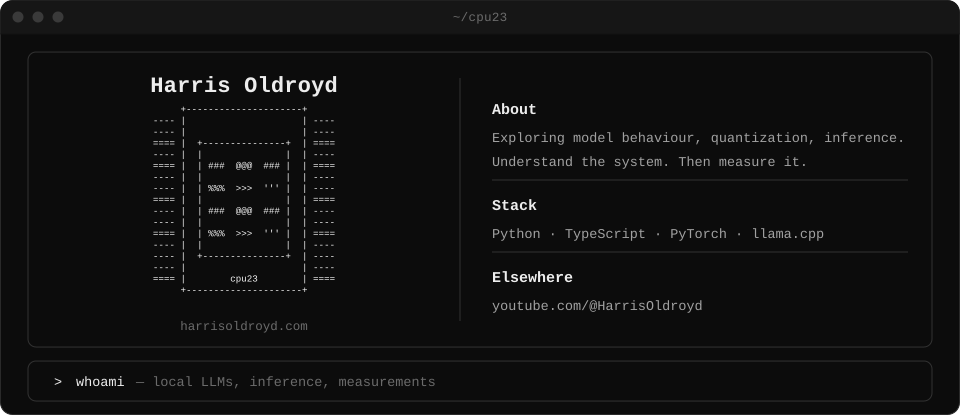

  <a href="https://www.youtube.com/@HarrisOldroyd">YouTube</a> ·
  <a href="https://harrisoldroyd.com">Website</a>

I explore how AI works, build things with it, and explain what I learn.

My focus is on **LLMs, local inference, and the software and hardware behind them**. I like understanding systems from first principles, testing ideas against real measurements, and making the results useful to other people.

## What I work on

- **AI research & experiments** — exploring model behaviour, quantization, inference performance, and the tradeoffs behind running models locally.
- **Open-source software** — building tools for experimenting with AI and understanding the systems underneath it.
- **Technical writing & explainers** — turning complex ideas into clear explanations, interactive demos, and reproducible benchmarks.

If you're working on local AI, inference, or tools that help people understand these systems, I'd love to hear what you're building.
